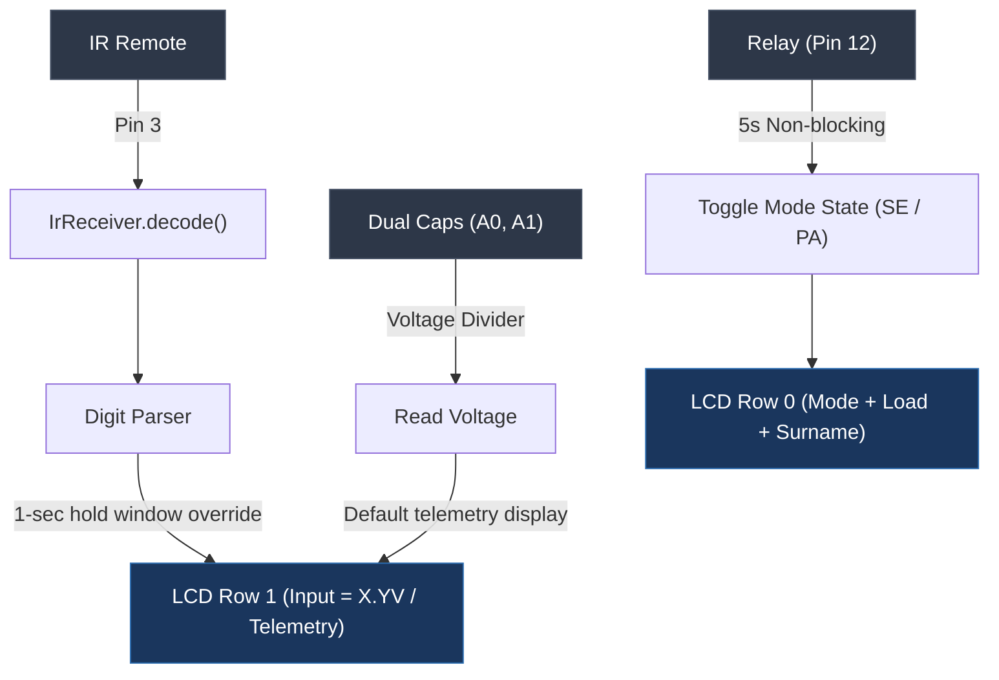

---
tags:
  - project/embedded
  - stage-4
  - tinkercad
  - arduino
date: 2026-11-04
status: In Progress
circuit_url: https://www.tinkercad.com/things/ftmiEIEwoL6-phase-42
---

# Stage 4 Development Notes: Input Capture, Display Logic & Standalone Integration

## 1. Aim of the Phase
The primary objective of Stage 4 is to establish and validate the user interface and input capture subsystems in a standalone configuration prior to integrating active output regulation:
* Interface an **IR receiver** on digital pin `3` to capture and decode remote button presses.
* Capture user voltage setpoints as a sequential **two-digit numerical input** (integer and fractional components).
* Display the entered voltage target on a $16 \times 2$ **I2C LCD** (`0x27`) temporarily overriding row 1, holding for a defined timeout (1 second), and automatically reverting back to live capacitor voltage telemetry.
* Maintain deterministic, non-blocking time-sharing between the background relay cycling ($5000\text{ ms}$ dwell time)[cite: 28], analog voltage sampling (`A0`, `A1`)[cite: 28], and asynchronous IR command reception[cite: 28].

---

## 2. Problems Faced

### 2.1. Blocking UI Transitions vs. State Timing
* **Symptom:** Retaining the IR user input on Row 1 of the LCD for a full second without freezing the relay toggle or causing missed IR packets.
* **Root Cause:** Standard sequential logic using `delay(1000)` halts microcontroller execution, preventing immediate response to incoming IR pulses and stalling the periodic relay toggle.

### 2.2. Truncated Hex/Decimal IR Key Codes
* **Symptom:** Digit `8` was failing to register reliably or resulted in misclassifications during keypad entry[cite: 28].
* **Root Cause:** In the raw decoder lookup table, the value mapped to key `8` (`386044697`)[cite: 28] was truncated by one digit relative to the remaining standard 32-bit decoded raw data constants (e.g., key `0` is `4077698816`)[cite: 28].

### 2.3. LCD Artifacts and Telemetry Overwriting
* **Symptom:** When switching between telemetry display and the `"Input = X.XXV"` string, characters from the previous mode remained visible on the right half of the display.
* **Root Cause:** Incomplete line-clearing or fixed string padding when shifting between strings of varying character lengths without issuing a full, slow `lcd.clear()`.

### 2.4. Relay & Sensor Interaction with IR Interrupts
* **Symptom:** Rapid cycling or noise caused intermittent decode failures on pin 3 when analog reads and serial outputs fired continuously.
* **Root Cause:** Loop cycle timing was governed by an unconditional `delay(200)`[cite: 28] at the bottom of `loop()`, making the IR check window sensitive to timing jitter.

---

## 3. Issues Resolved

### 3.1. Non-Blocking IR Display Timeout Logic
Implemented state flags (`showingIRResult`, `firstDigit`, `secondDigit`) alongside a millisecond-based deadline (`irDisplayUntil`)[cite: 28]:
* When `firstDigit` is captured, Row 1 is overridden immediately with `"Input = X.00V   "`[cite: 28].
* When `secondDigit` arrives, the final value `"Input = X.YV    "` is shown, and `irDisplayUntil` is armed for `millis() + 1000`[cite: 28].
* Normal dual-capacitor telemetry (`vBoth` on the left, `vOne` on the right) automatically reclaims Row 1 only when `millis() >= irDisplayUntil`[cite: 28].

### 3.2. Code Sanitization for Keypad Decoding
* Corrected the raw IR lookup map to ensure full 32-bit unsigned integrity across all digits ($0\text{--}9$)[cite: 28].
* Structured the single-digit gatekeeper so unrecognized keys return `-1` without mutating the current input buffer[cite: 28].

### 3.3. Deterministic LCD Row Formatting
* Structured Row 0 to permanently show switching state (`"PA"` / `"SE"`)[cite: 28], a load regulation placeholder (`"--.--V"`)[cite: 28], and right-aligned surname (`surname = "Mtembu"`)[cite: 28].
* Added trailing blank spaces to Row 1 string literals (`"Input = X.YV    "`) to wipe residual characters without triggering the visual flicker associated with `lcd.clear()`.

---

## 4. Current Subsystem State & Next Transition

* **Validated:** Dual voltage readings, non-blocking relay toggling, and temporary LCD override via remote input[cite: 28]. * **Pending Stage 5:** Incorporate `pinLoad` (`A3`)[cite: 28], implement the closed-loop buck/boost or linear regulator control stage, and map the captured IR target voltage to the active feedback loop