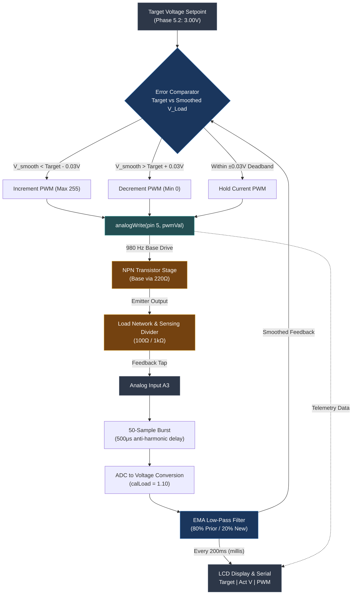

---
tags:
  - project/embedded
  - stage-5
  - voltage-regulation
  - closed-loop
  - arduino
date: 2026-11-04
status: Verified
---

# Stage 5 Development Notes: NPN Voltage Regulation & Closed-Loop Control

## 1. Aim of the Phase
To design, characterize, and validate a standalone, closed-loop DC voltage regulation circuit using an NPN power transistor driven by Arduino PWM (pin `5`) and real-time voltage feedback via `A3`:
* **Phase 5.1 (Open-Loop Characterization):** Sweep PWM values across $0\text{--}255$ in steps of 25 to establish the transfer function between base duty cycle, raw ADC feedback, and actual output voltage across the load divider ($100\,\Omega / 1\,\text{k}\Omega$).
* **Phase 5.2 (Closed-Loop Regulation):** Implement an active feedback tracking loop to regulate the emitter load node to a hardcoded target ($3.00\,\text{V}$) within the target operational range ($0\text{--}4.30\,\text{V}$) prior to coupling with user IR input.
* Prove stable loop convergence, mitigate PWM switching ripple from the ADC sampling path, and display live target vs. actual telemetry on the $16 \times 2$ I2C LCD.

---

## 2. Problems Faced

### 2.1. Severe ADC Inconsistency from 980 Hz PWM Ripple
* **Symptom:** Raw `analogRead(A3)` values oscillated erratically, causing the feedback loop to hunt, jitter, and overcompensate.
* **Root Cause:** Pin 5 generates a $980\,\text{Hz}$ square wave. Because the ADC takes instantaneous snapshot readings without a heavy hardware RC filter on the emitter feedback divider, it repeatedly sampled the switching peaks and valleys of the ripple instead of true average DC.

### 2.2. Harmonic Aliasing During Periodic Sampling
* **Symptom:** Taking fixed $1\,\text{ms}$ or $2\,\text{ms}$ delays between ADC reads created a beat frequency (aliasing) against the $980\,\text{Hz}$ PWM switching cycle, causing slow, cyclical drifts in the calculated voltage.
* **Root Cause:** Periodic synchronous polling aligned with repeating phases of the PWM waveform.

### 2.3. Control Hunting and Limit-Cycle Oscillation
* **Symptom:** The PWM actuator duty cycle continuously toggled between adjacent values (e.g., $182 \leftrightarrow 183$), inducing visual and electrical jitter.
* **Root Cause:** A direct bang-bang threshold without a deadband forced the controller to increment or decrement even when the measured output was within acceptable operational tolerance of the target.

### 2.4. LCD Refresh Bottlenecks Delaying the Control Loop
* **Symptom:** Updating the I2C LCD on every loop pass dropped the control cycle frequency down to double-digit Hertz, causing sluggish response times to load variations.
* **Root Cause:** The I2C bus write operations at standard $100\,\text{kHz}$ block the CPU while sending multi-byte display strings.

---

## 3. Issues Resolved

### 3.1. Dual-Stage Digital Signal Conditioning (Oversampling + EMA)
Engineered a two-tier filtering strategy in software:
* **Asynchronous Multi-Sample Burst:** Implemented a 50-sample loop utilizing a `delayMicroseconds(500)` offset. This $0.5\,\text{ms}$ phase offset breaks harmonic alignment with the $1.02\,\text{ms}$ period ($980\,\text{Hz}$) of the PWM timer.
* **Exponential Moving Average (EMA):** Applied a recursive low-pass filter:
  $$V_{\text{smooth}}[k] = 0.8 \cdot V_{\text{smooth}}[k-1] + 0.2 \cdot V_{\text{raw}}[k]$$
  This eliminates high-frequency transitions while allowing clean tracking of the DC baseline.

### 3.2. Deadband Slew Rate Controller
Replaced naive threshold comparisons with an incremental deadband governor:
* **Deadband Window:** Set to $\pm 0.03\,\text{V}$ around `targetVoltage`.
* **Zero Clamp:** If `targetVoltage <= 0.05V`, PWM forces a clean zero cut-off.
* **Gradual Slew:** Increments/decrements `pwmVal` by $\pm 1$ per control frame, preventing violent overshoot and inductive ringing across the circuit.

### 3.3. Asynchronous Non-Blocking Telemetry Staging
* Decoupled the high-speed feedback loop from the display subsystem using a non-blocking `millis() - lastUpdate >= 200` gate.
* Closed-loop regulation runs at full loop execution speed, while LCD and serial logging are restricted to a stable $5\,\text{Hz}$ ($200\,\text{ms}$) update rate.

---

## 4. Subsystem Verification & Metrics

* **Phase 5.1 Verification:** Open-loop sweep demonstrated monotonic linear scaling between PWM values from $0$ up to saturation, confirming that the calibration factor ($\text{calLoad} = 1.10$) accurately translates the emitter-node divider voltage.
* **Phase 5.2 Verification:** With `targetVoltage = 3.00V`, the output settled smoothly at $3.00\,\text{V} \pm 0.02\,\text{V}$, holding a steady PWM value without oscillation.
* **Next Integration (Phase 6 / Final):** Tie `targetVoltage` to the user-entered IR two-digit buffer from Stage 4, replacing the hardcoded $3.00\,\text{V}$ constant.

