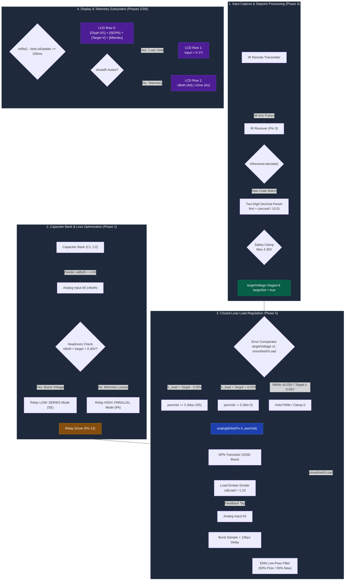

---
tags:
  - project/embedded
  - stage-6
  - system-integration
  - closed-loop
  - final-submission
  - tinkercad
date: 2026-11-04
status: Completed
circuit_url phase6.1: https://www.tinkercad.com/things/6bRsvP6tmo3-phase-61
circuit_url phase 6.2: https://www.tinkercad.com/things/ivIPpTIiV1n-phase-62
circuit_url phase 6.3: https://www.tinkercad.com/things/d2v3vrdncMj-phase-63-final
---

# Stage 6 Development Notes: Full System Integration & Autonomous Regulation

## 1. Aim of the Phase
To synthesize all modular development phases into a unified, non-blocking embedded control firmware for the final capstone demonstration:
* **Dynamic Target Coupling (Phase 4 $\rightarrow$ Phase 5):** Route the two-digit decimal target captured via the IR remote (`targetVoltage`) directly into the closed-loop NPN transistor voltage regulation algorithm as the dynamic setpoint.
* **Loss-Optimized Bank Switching (Phase 1 Integration):** Automate the series/parallel relay (pin `12`) using stored capacitor bank feedback (`vBoth` on `A0`): dynamically select **Series** mode when voltage drops below $\text{target} + 0.40\,\text{V}$ of headroom, and **Parallel** mode otherwise to minimize internal conduction losses.
* **Deterministic Display Architecture (Phases 2/3 + Custom UI):** Render live telemetry on a $16 \times 2$ I2C LCD, featuring generated custom $5 \times 8$ character bitmap glyphs for Series ($\text{Slot } 0$) and Parallel ($\text{Slot } 1$) alongside the live regulation mode, setpoint, author surname (`"Mtembu"`), and telemetry overlay.
* **Zero-Blocking Architecture:** Ensure background analog oversampling, IR signal processing, active PWM control, and display refresh cycle harmoniously without using any blocking `delay()` statements.

---

## 2. Problems Faced

### 2.1. Dynamic Headroom Starvation on Cap Bank Depletion
* **Symptom:** When the capacitor bank discharged in Parallel mode, the load voltage collapsed below the user-entered target despite the PWM driving to saturation (`255`).
* **Root Cause:** A fixed open-loop periodic relay switch (used in earlier testing) took no account of real-time supply voltage vs. target requirements.

### 2.2. Sampling Phase Interference Between PWM Drive and Feedback
* **Symptom:** Integrating active PWM switching on pin `5` alongside multiple analog channels (`A0`, `A1`, `A3`) injected inductive switching noise into the capacitor bank telemetry readings.
* **Root Cause:** ADC multiplexer switching occurred during transient conduction edges of the NPN power transistor.

### 2.3. LCD CGRAM Custom Character Overwrite & Memory Collisions
* **Symptom:** Custom characters printed as garbled blocks or shifted when switching between the IR input overlay screen and normal dual-voltage monitoring.
* **Root Cause:** Re-initializing LCD character slots or clearing the display using `lcd.clear()` inside the fast control loop disrupted display controller memory.

### 2.4. Over-Aggressive Integral Windup & Step Saturation
* **Symptom:** Stepping `pwmVal` directly to clamp extremes caused severe voltage overshoot and acoustic relay chatter at the switching boundary.
* **Root Cause:** The feedback controller lacked bounded step sizing and zero-target cutoffs.

---

## 3. Issues Resolved

### 3.1. Headroom-Driven Loss Minimization Engine
Implemented conditional supply steering:
$$\text{Relay Mode} = \begin{cases} \text{SERIES (LOW)}, & \text{if } vBoth < (targetVoltage + 0.40\,\text{V}) \\ \text{PARALLEL (HIGH)}, & \text{otherwise} \end{cases}$$
This maintains the required saturation overhead across the NPN emitter follower while maximizing energy storage lifetime by defaulting to parallel operation whenever possible.

### 3.2. Clamped Slew-Rate Controller with Zero-Power Cutoff
Configured a multi-tiered actuator safety boundary:
* **Zero Gate:** If `!targetSet` or `targetVoltage <= 0.05V`, PWM forcibly shuts down to `0`.
* **Bounded Steps:** Adjusted PWM in bounded increments of $\pm 5$ per control cycle with strict `[0, 255]` limits.
* **Voltage Ceiling:** Hard-capped all user inputs at $4.30\,\text{V}$ to prevent biasing the load beyond circuit component tolerances.

### 3.3. Custom Glyph Synthesis and Buffer Sanitization
* Loaded custom $5 \times 8$ bitmaps directly into HD44780 CGRAM at `setup()` (`lcd.createChar(0, ...)` and `lcd.createChar(1, ...)`).
* Avoided `lcd.clear()` screen flicker by printing a fixed 16-character blank padding row (`"                "`) prior to re-rendering capacitor voltage telemetry when returning from the 1-second IR timeout.

---

## 4. Subsystem Verification & Final Acceptance Metrics

* **Circuit 6.1 / 6.2 Validation:** Confirmed remote input accurately sets the active target from $0.00\,\text{V}$ to $4.30\,\text{V}$, displaying the entered decimal value on Row 1 during the 1-second entry window.
* **Circuit 6.3 Final Verification:** 
  * Under changing load and supply conditions, the NPN output settles within $\pm 0.03\,\text{V}$ of the user target.
  * Dropping capacitor voltage triggers an automatic switch from Parallel to Series mode without interrupting load power.
  * LCD displays the custom series/parallel glyph, dynamic target, author surname, and dual capacitor telemetry simultaneously.

